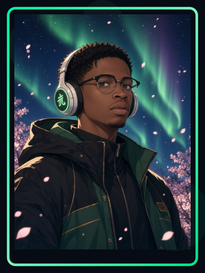
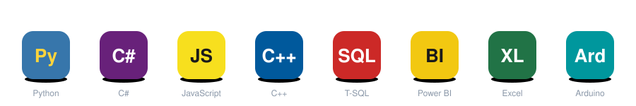
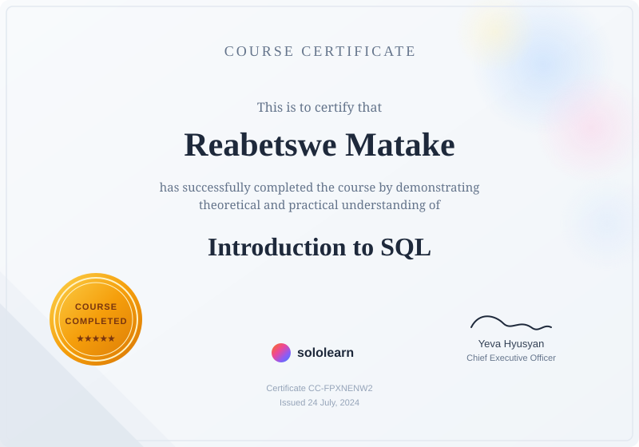

Germiston, South Africa · [Portfolio](https://rea2003.github.io/ReabetsweMakeportfolio/) · [GitHub](https://github.com/Rea2003) · [Email](mailto:ReabetsweMatake@gmail.com)

<table>
<tr>
<td width="62%" valign="top">

<h2>Building With Purpose</h2>

I design and build <b>databases, dashboards, and small intelligent systems</b>, from SQL Server back ends to interactive web visualizations and Arduino prototypes.

My focus is on turning raw data and real-world problems into clean, reliable, and useful tools that create real change in my community.

<table>
<tr>
<td><b>Languages</b> Python · C# · JavaScript · C++</td>
<td><b>Data &amp; BI</b> Power BI · Excel · Chart.js</td>
</tr>
<tr>
<td><b>Databases</b> T-SQL · SQL Server 2022 · ETL</td>
<td><b>Tools</b> GitHub · Visual Studio · SSMS · Arduino IDE</td>
</tr>
</table>

</td>
<td width="38%" valign="top" align="center">

</td>
</tr>
</table>

## About Me

My passion for technology began in Grade 6 in Katlehong. With no laptop at home, I taught myself HTML and CSS on the Sololearn app, downloading lessons over public Wi-Fi to study offline, and later wrote my school IT project code by hand in a workbook.

Today I'm a final-year Bachelor of Computing student specializing in **Business Intelligence**, driven to build technology that creates real change in my community.

**Core competencies:** Database Normalization (3NF) · Data Warehousing · SLA Tracking · POPIA Compliance · Problem Solving · Team Collaboration

 

---

## Education

**Bachelor of Computing in Business Intelligence**
Belgium Campus ITversity, Gauteng, South Africa · September 2023 – Present

- Specializing in data analytics, business intelligence systems, and database technologies
- Coursework includes data warehousing, ETL processes, statistical analysis, and data visualization

**National Senior Certificate (Science Stream)**
Katlehong Secondary School · January 2018 – December 2022

---

## Featured Projects

### Maximum Security Services: Database Management System
`SQL Server 2022` `T-SQL` `Database Design`

- Designed a 3NF-normalized SQL Server database unifying client data, incident logs, and automated billing for a security services company
- Implemented real-time SLA tracking and POPIA-compliant encryption with audit logging
- Built with Anele Nkayi, Tristan Roets, and Dillon Wolmarans

[View project →](https://github.com/Rea2003/Maximum-Security-Services)

### HeroLegends: Superhero Management System
`C#` `.NET Framework 4.7.2` `WinForms` `MaterialSkin` `LiveCharts`

A desktop application for capturing, updating, and monitoring superhero data, with a clean 3-layer architecture (presentation, business, and data layers).

- Full CRUD for hero records in a structured DataGridView, with validation and duplicate Hero ID prevention
- Automatic rank assignment (S, A, B, C) from exam score, plus automatic threat level classification
- Real-time UI refresh using `FileSystemWatcher`, which monitors the text-file data store for changes
- Interactive dashboard with LiveCharts for hero statistics and performance insights, in a Material Design UI
- Built with Ngcebo Enock Mntungwa and Nyameko Kraai (Group 21)

[View project →](https://github.com/Rea2003/HeroLegends)

### FitXlog: Dashboard Web App
`JavaScript` `Chart.js` `HTML` `CSS`

- Built a responsive fitness tracking web app with dynamic Chart.js visualizations for workout trends and calorie analytics
- Developed goal-setting features, a 7-day challenge system, and achievement badges

[View project →](YOUR_PROJECT_LINK)

### Arduino Smart Smoke & Gas Detector
`Arduino UNO` `C++` `MQ-2 Sensor`

- Prototyped an IoT safety device using an MQ-2 sensor to detect smoke and gas levels in real time
- Programmed alarm triggers, an LCD status display, and a manual silencer in Arduino C++

[View project →](https://github.com/Rea2003/Gas-Smoke-Dection-System)

<i>More projects coming soon. Always learning, always building.</i>

---

## Certifications

<table>
<tr>
<th align="left" width="45%">Details</th>
<th align="center" width="55%">Certificate</th>
</tr>
<tr>
<td valign="top">
<b>Introduction to SQL</b> 
Sololearn · Completed 24 July 2024  
SQL fundamentals covering querying, filtering, joins, aggregation, and data extraction.  
<a href="https://www.sololearn.com/certificates/CC-FPXNENW2">View certificate →</a>
</td>
<td valign="middle" align="center">

</td>
</tr>
<tr>
<td valign="top">
<b>Machine Learning for Beginners</b> 
Sololearn · Completed 26 september 2026  
Hands-on training in machine learning fundamentals, including training and testing models and using generative AI.  
<a href="https://www.sololearn.com/certificates/CC-NQHM1GR7">View certificate →</a>
</td>
<td valign="middle" align="center">

</td>
</tr>
</table>

---

## Beyond Tech

Outside of tech I explore **music, poetry, visual storytelling, and creative projects**, another way to express ideas while learning new skills.

**Reah23: I Forgave You**

My second-ever beat and one of my first visual projects. I've wanted to explore music since I was young, so I made this record with BandLab and edited the visuals in Clipchamp.

<b>Click the image to watch on YouTube</b>

---

## Languages

**Sesotho:** Native · **Setswana:** Fluent · **English:** Intermediate (Professional Working Proficiency) · **Zulu:** Intermediate

---

## GitHub Stats

